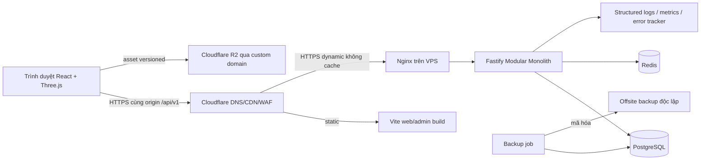

# Kiến trúc phần mềm — bản thiết kế MVP

> Runtime MVP đã triển khai trong apps/{web,admin,api} và packages/{contracts,game-config,game-core,ui}. Backend gom các miền player/profile/inventory/wallet/shop/missions/collection/leaderboard vào module players dùng transaction chung để giảm lớp rỗng ở MVP; auth, fishing, admin và analytics có module riêng. Contracts kiêm validation; không tạo packages/shared/validation chỉ để đủ tên. Source runtime và IMPLEMENTATION_CONTRACT là nguồn chính khi khác sơ đồ Discovery bên dưới. Deployment ngoài máy local chưa thực hiện.

Ngày: 07/11/2026. Trạng thái: đề xuất Discovery; chưa có application runtime.

Auth email/password chỉ dùng phát triển nội bộ. Beta/public phụ thuộc [LEGAL.md](LEGAL.md), mô hình định danh và tuổi/người giám hộ, kiểm soát thời gian chơi cùng đánh giá privacy; kiến trúc và schema cần cập nhật trước khi thu dữ liệu người chơi thật.

## Ranh giới và lựa chọn

Modular Monolith: một API và một PostgreSQL, chia quyền sở hữu nghiệp vụ theo module. Giao dịch nhận cá, ví, XP, bộ sưu tập và nhiệm vụ cần nguyên tử nên cùng database giúp giảm lỗi phân tán và chi phí vận hành. Đổi lại cần kiểm tra dependency để module không truy cập repository của nhau tùy tiện. Không tách microservice hoặc thêm Socket.IO khi polling theo phiên câu đã đáp ứng MVP.

| Thành phần                | Trách nhiệm                                                                                        | Không làm                                       |
| ------------------------- | -------------------------------------------------------------------------------------------------- | ----------------------------------------------- |
| React + TypeScript + Vite | Auth, lobby, profile, inventory, shop, missions, admin                                             | Render từng frame hoặc quyết định thưởng        |
| Three.js (3D)             | Cảnh hồ 3D, model cá/trang bị, input chạm, animation; nội suy trạng thái đã được server chấp thuận | Tự chọn cá, cân nặng, Gold, XP                  |
| Zustand                   | UI state, tùy chọn âm thanh, tham chiếu phiên chơi                                                 | Là nguồn sự thật ví/inventory                   |
| TanStack Query            | Fetch, cache, invalidate dữ liệu API, retry có kiểm soát                                           | Retry mutation có side effect thiếu idempotency |
| Fastify + Zod             | Auth, validation, authorization, state machine, gameplay/economy services                          | Tin kết quả do client gửi                       |
| Prisma + PostgreSQL       | Transactions, ledger, unique/FK/index, durable game state                                          | Dùng Redis làm sổ cái                           |
| Redis                     | Rate limit, cache cấu hình có version, khóa phụ trợ tùy nhu cầu                                    | Khóa nghiệp vụ duy nhất thay row lock Postgres  |
| CSS Modules + packages/ui | Semantic design tokens, component tái sử dụng                                                      | Trộn UI admin vào game canvas                   |

## Sơ đồ hệ thống



Origin TLS strict, không mở DB/Redis ra Internet. Asset public có hash; không lưu bí mật trong R2 public bucket. Dynamic route `Cache-Control: no-store`, đặc biệt auth và trạng thái phiên.

## Cấu trúc dự kiến, chưa scaffold

```text
apps/web/src/{app,features,game}
apps/admin/src/{app,features}
apps/api/src/{bootstrap,modules,plugins}
packages/shared       # types độc lập UI/backend
packages/contracts    # request/response Zod và API DTO
packages/validation   # validation dùng chung thật sự, không business policy
packages/game-core    # state machine/reward/XP thuần; server là authority
packages/game-config  # schema cấu hình, không hardcode production config
packages/ui           # tokens/component cho React
infrastructure/{docker,nginx,scripts}
docs/
```

Mỗi module API có controller/routes, schema, service và repository khi có persistence; không tạo lớp repository rỗng chỉ để đủ khuôn mẫu. Các module: auth, users, profiles, fish, locations, fishing, inventory, equipment, wallet, missions, achievements, leaderboard, shop, notifications, admin, analytics. Notifications MVP chỉ là thông báo trong app. Reward, mission progress, ledger và AnalyticsEvent nghiệp vụ được ghi cùng transaction; AnalyticsEvent là outbox nhỏ có processedAt/attempts, worker retry và consumer dedupe. Không thêm broker chỉ để có analytics; event UI không quan trọng có thể gửi client, không ảnh hưởng thưởng.

Import rule: app UI → contracts/UI/game-core; controllers → service; service sở hữu module → repository. Admin gọi cùng domain service có RBAC và audit. Packages không import apps. Frontend không import Prisma, server secrets hoặc cấu hình chọn cá nội bộ.

## Giao thức phiên câu

1. Tạo session từ location, inventory đã equip và bait; server kiểm tra sở hữu, lượng mồi, level, Gold phí vào hồ. Snapshot configVersion và stat trang bị; một session chưa FINISHED/player.
2. Cast có `Idempotency-Key` và `expectedVersion`; transaction tiêu hao một mồi đúng một lần, quyết định random server, `biteAt` trong 3–8 giây. Payload WAITING không lộ loài, trọng lượng, xác suất hay biteAt tương lai.
3. Client poll mỗi khoảng 500ms khi WAITING; chỉ được trả BITE sau thời điểm bite. Timer sử dụng clock server, không dùng timestamp client làm căn cứ. Cửa sổ hook cấu hình theo loài 1,4–2,4 giây, tutorial rộng hơn, allowance mạng server tối đa150ms theo GDD; mạng trễ là rủi ro UX cần beta đo.
4. Hook đúng hạn: HOOKING → FIGHTING. Client gửi hành động `hold`/`release` mỗi250ms (4Hz); server tích phân elapsed time theo simulation tick 50ms có catch-up cap, tự áp dụng escape/tension theo thời gian kể cả khi client không gửi. API từ chối khoảng input dưới250ms. Input hold hết TTL 350ms thì chuyển release. Mất kết nối kéo dài dẫn ESCAPED; retry không tạo thêm lực kéo.
5. Tick làm đủ progress: REELING → CAUGHT. Transaction khóa session + wallet, tạo catch có unique sessionId, cộng ledger/XP/collection/mission nguyên tử. Các replay trả cùng kết quả. `complete` chỉ đóng trạng thái đã có, không phải endpoint tự cấp thưởng.
6. ESCAPED hoặc CAUGHT → FINISHED. TTL inactivity 60 giây và total TTL 5 phút: request tiếp theo/job cleanup chuyển phiên treo thành ESCAPED rồi FINISHED, không thưởng; trả lỗi/terminal response rõ ràng. Có thể tạo session mới sau finalize.

Mỗi transition tăng version; sai expectedVersion trả 409. Server xử lý due transition bằng timestamp trong request/job; không dựa vào timer process duy nhất vì API có thể restart. Mọi lựa chọn random dùng CSPRNG phía server và lưu kết quả kín; không có seed dự đoán được gửi frontend.

## Tính nhất quán và cache

- Wallet Gold `BigInt`, không float; response serialized thành chuỗi số nguyên. XP và giá không âm, kiểm tra overflow/giới hạn cấu hình.
- Reward transaction lấy khóa theo thứ tự session → wallet → profile → collection → mission để giảm deadlock; retry transaction conflict giới hạn, cùng idempotency key.
- Cache config theo immutable version; publish admin tạo version mới, audit before/after. Phiên đang chạy tiếp tục snapshot cũ. Không sửa giá/loot của session giữa chừng.
- Logout/revoke refresh ngay; access JWT TTL 10 phút, refresh7 ngày (sliding có absolute cap30 ngày). Access JWT gắn familyId; mọi authenticated request kiểm tra family còn hiệu lực qua Redis cache có invalidation và DB fallback. Logout/reset/suspend invalidates family trước response, fail closed nếu không thể xác nhận; không cho token access cũ tiếp tục cấp thưởng. Admin kiểm tra role/revocation DB mỗi request nhạy cảm.
- Một mồi tiêu hao ở cast; mất mạng không hoàn mồi tự động. Hỗ trợ có quy trình bồi hoàn qua ledger + audit, không sửa balance tay.

## Nghiệm thu kiến trúc trước alpha

Build/typecheck toàn workspace bằng pnpm; web/admin không chứa secret; server-authoritative catch vượt bộ test replay/race; PostgreSQL rollback không có cá thiếu ledger; restart API giữa WAITING/FIGHTING khôi phục/expire đúng; DB/Redis unreachable trả lỗi có mã, không thưởng cục bộ; metrics đo latency/state errors thay vì log token/password. Xem [API](API.md), [database](DATABASE.md), [security](SECURITY.md), [deployment](DEPLOYMENT.md).

## Mở rộng payments 07/11/2026

Module `apps/api/src/modules/payments` dùng cùng PostgreSQL và transaction/players services; strategy adapters MoMo/VNPay/card, receipt/fulfillment/notification outbox và authenticated WebSocket. Redis đã có được tái sử dụng cho fan-out nhiều API instances; polling gameplay giữ nguyên. Catalog VND độc lập Gold. Xem [sơ đồ kiến trúc và sequence payment](PAYMENTS.md).
