# Database và lưu trữ

## Runtime MVP — cập nhật 07/11/2026

Nâng cấp simulator: migration `202611070008_lake_community` thêm `lake_messages` (user/location/text/catch snapshot/createdAt), index truy vấn tin theo điểm câu và index catch cho bảng tuần/kỷ lục từng loài. State vật lý, conditions và tackle ở JSON simulation/snapshot của session; chiều dài/địa điểm/mồi/cần nằm trong reward snapshot catch. Migration không cập nhật dữ liệu kinh tế hoặc lịch sử hiện có. Đã xác minh migrate/seed trên database kiểm thử riêng; cần chạy `rtk proxy pnpm db:migrate` khi đưa thay đổi vào database ứng dụng. Source còn có migration từ các module khác đang phát triển; danh sách chính xác ở `apps/api/prisma/migrations`.

Schema đang chạy: [apps/api/prisma/schema.prisma](../apps/api/prisma/schema.prisma); cấu hình Prisma7 ở [prisma.config.ts](../apps/api/prisma.config.ts). Hai migration `202611070001_initial` và `202611070002_integrity` đã được áp dụng trên PostgreSQL15.18 native. Docker/CI cấu hình PostgreSQL16; chưa chạy Docker daemon trên máy này.

- Seed TypeScript idempotent có 37 cá, 6 điểm câu, gear/baits/shop, 3 missions và 3 achievements. Seed bổ sung nội dung còn thiếu và giữ cấu hình active/admin edits; không tạo default user/admin. Đăng ký cấp starter trong transaction: 200 Gold/20 giun và 1 item mỗi slot.
- SQL migration có partial unique cho session mở/config active/bait stack; CHECK lượng, giá, chỉ số; trigger append-only ledger/audit/grants; cấu hình published không sửa value; trigger ownership/slot của đồ trang bị.
- Số dư ví được kiểm đối soát SUM ledger bằng constraint trigger deferred lúc commit. Gameplay/economy khóa player/session và stock, dùng idempotency/hash và unique business refs. Ledger được ghi cùng catch/order/mission/profile trong transaction.
- `docs/design/schema.prisma` giữ vai trò hồ sơ Discovery, không dùng migrate/runtime. `runtimeConfig` và snapshot phiên là nguồn cân bằng; cờ active ở bảng danh mục vẫn được tôn trọng khi publish cấu hình khác.
- Restore/backup local được kiểm riêng và ghi bằng chứng ở PROJECT_STATUS. Script backup tạo pg_dump custom và kiểm danh sách archive; chưa tự cung cấp mã hóa/offsite/WAL. Script `infrastructure/scripts/runtime-role.sql` cấp fwo_app quyền runtime không superuser/DDL/TRUNCATE, không UPDATE ledger/audit/grants; đã xác minh đăng ký và mua hàng qua API với role này trên database test. Credential owner dùng riêng cho migrate; compose vẫn là template vận hành chưa được chạy Docker thực.

## Thiết kế Discovery lưu tham khảo

Các mục tương lai bên dưới mô tả thiết kế ban đầu; ưu tiên phần runtime trên và source code khi có khác biệt. Ngày: 07/11/2026. [Schema Prisma](design/schema.prisma) là đề xuất thiết kế theo cú pháp Prisma 7.10.1, chưa sinh client, migration hoặc seed. Bản schema gốc đã pass `validate --schema docs/design/schema.prisma` bằng Prisma CLI 7.10.1 có sẵn (exit 0); không cài runtime dependency và chưa kiểm thử migration/database. Connection URL sẽ được cung cấp qua `apps/api/prisma.config.ts` trong Foundation; không đặt `datasource.url` trong schema. Foundation phải audit tương thích Node, pin toolchain và kiểm tra migration trên PostgreSQL thật. PostgreSQL là nguồn sự thật; Redis không giữ số dư.

Email/password trong schema hiện chỉ phục vụ phát triển nội bộ. Trước beta có người chơi ngoài nhóm phát triển, cần rà soát [LEGAL.md](LEGAL.md) để bổ sung mô hình định danh/tên-ngày sinh-số điện thoại, xác minh, tuổi/người giám hộ, giới hạn thời gian chơi và retention theo quy định thực tế áp dụng. Không thu thập dữ liệu định danh thật ở Discovery; schema này chưa chứng minh đủ điều kiện phát hành và không tự kết luận phân loại G1–G4.

## ERD cốt lõi

```mermaid
erDiagram
  User ||--|| UserProfile : has
  User ||--o{ UserSession : authenticates
  User ||--|| Wallet : owns
  Wallet ||--o{ WalletTransaction : records
  User ||--o{ UserInventory : owns
  User ||--o{ UserEquipment : equips
  Equipment ||--o{ EquipmentStat : has
  Equipment ||--o{ UserInventory : instances
  BaitType ||--o{ UserInventory : stacks
  FishingLocation ||--o{ LocationFish : allows
  FishSpecies ||--o{ LocationFish : inhabits
  User ||--o{ FishingSession : starts
  FishingLocation ||--o{ FishingSession : hosts
  FishingSession ||--o{ FishingAction : records
  FishingSession ||--o| FishingCatch : produces
  FishSpecies ||--o{ FishingCatch : identifies
  User ||--o{ FishCollection : collects
  FishSpecies ||--o{ FishCollection : species
  User ||--o{ ShopOrder : purchases
  ShopItem ||--o{ ShopOrder : sells
  Mission ||--o{ UserMission : assigned
  User ||--o{ UserMission : progresses
  Achievement ||--o{ UserAchievement : unlocks
  User ||--o{ UserAchievement : earns
  User ||--o| AdminUser : authorized
  User ||--o{ AuditLog : actor
  SystemConfig ||--o{ FishingSession : versions
  User ||--o{ AnalyticsEvent : emits
  User ||--o{ UserGrant : receives
```

Sơ đồ ưu tiên quan hệ nghiệp vụ; tên vật lý map snake_case trong schema. FK còn lại xem file schema. Các bảng cấu hình có slug/key unique để seed upsert; UUID PK và `timestamptz` UTC. Quy ước ngày daily mission dùng Asia/Ho_Chi_Minh khi tính periodKey (`2026-11-07`), timestamp vẫn lưu UTC. Không reset tiến độ bằng cron xóa dữ liệu.

## Những ràng buộc cần migration SQL

Prisma không biểu diễn toàn bộ constraint/trigger cần thiết. Foundation phải thêm vào SQL migration, kiểm thử trên PostgreSQL thật:

- Partial unique index `fishing_sessions(user_id) WHERE state <> 'FINISHED'`; expire/finalize session treo trước khi tạo mới. Không chỉ kiểm tra rồi INSERT ngoài transaction.
- CHECK wallet.balance >= 0; ledger delta khác 0; quantity >= 0; XP >= 0; cá min_weight_g > 0 và max >= min; reward/price không âm; catch weight hữu hạn trong range snapshot.
- UserInventory có đúng một FK equipmentId hoặc baitTypeId. Equipment instances quantity=1; bait stack unique `(user_id,bait_type_id)` partial, equipment nullable không dựa composite unique với NULL. Unique active equip mỗi `(user_id,slot)`, inventory không được trang bị bởi người khác (service trong transaction hoặc FK composite bổ sung).
- WalletTransaction là append-only: role runtime không UPDATE/DELETE ledger, trigger ngăn sửa/xóa. Tài khoản migration tách biệt. Không cascade delete ledger, orders, catches, audit; user xóa mềm/ẩn danh theo chính sách giữ dữ liệu.
- UserProfile.username unique case-insensitive bằng normalizedUsername; email normalized trước lưu. Không dùng unique raw email phân biệt hoa thường.
- Audit log append-only cùng cơ chế; bổ sung actor snapshot để điều tra sau khi tài khoản đổi tên.
- SystemConfig chỉ một isActive=true mỗi key bằng partial unique index; version đã publish bất biến. Chỉnh sửa tạo version mới; configSnapshot trong session tự đủ để khôi phục mô phỏng ngay cả khi các bảng danh mục thay đổi.
- ShopItem.grantQuantity>0 là số item một pack; mua quantity pack tạo quantity×grantQuantity đơn vị mồi, tránh nhầm giá30 Gold/10 giun thành 30 Gold/giun. Stock tính theo pack, snapshot order lưu đơn vị và giá lúc mua.
- UserGrant unique(userId,key,periodKey) lưu cứu trợ mồi; giữ lịch sử grant qua ngày, không dùng IdempotencyRecord TTL 24h làm kiểm soát duy nhất. Grant+inventory trong transaction kiểm điều kiện ví/mồi có lock, không tạo ledger Gold delta0.

## Transaction tiêu biểu

**Catch:** khóa session, kiểm tra version/state/catch chưa có → chọn kết quả đã định server → INSERT catch unique(session_id) → khóa wallet → INSERT ledger unique(wallet_id,idempotency_key), update balance → update profile XP/tổng cá/kỷ lục → upsert collection → update daily mission → set CAUGHT và version → commit. Bất kỳ lỗi nào rollback toàn bộ. API replay cùng key phải trả nguyên response đã lưu, key khác vẫn không có catch thứ hai.

**Shop:** bodyHash + idempotency key user-scoped → khóa wallet → kiểm tra stock/level/current price và config version → tạo order → ledger âm → update balance và inventory trong cùng transaction. Giá lấy từ server; stale giá báo 409 PRICE_CHANGED, không âm thầm mua giá khác.

**Mission claim:** khóa UserMission `(user,mission,period)` → kiểm tra criteriaSnapshot/target và completedAt trước hết ngày VN, claimedAt null → ledger thưởng, update claimedAt cùng transaction; claim grace đến 12:00 ngày sau, không thêm progress sau 00:00. Distinct species/tổng gram lấy từ catch ngày đó có dedupe/session; tránh chỉ tăng counter lặp. Concurrent claim chỉ một thành công kinh tế. Starter/catch/mission có ledger reason và unique business reference; MVP không có Gold level-up, support credit nếu triển khai sau cũng phải có ledger/audit.

**Analytics:** INSERT AnalyticsEvent cho sự kiện nghiệp vụ trong cùng transaction catch/purchase/claim; eventId unique. Bảng đồng thời là hàng đợi outbox nhỏ: worker claim row theo lock, cập nhật processedAt/attempts, retry có backoff; consumer dedupe theo eventId. Không cần thêm broker/microservice. Nếu telemetry external lỗi, gameplay vẫn đã commit và event chờ retry. Client events không có quyền cấp thưởng.

## Index và retention

| Truy cập        | Index/ràng buộc                                                                                                  |
| --------------- | ---------------------------------------------------------------------------------------------------------------- |
| Login/refresh   | User.emailNormalized unique; UserSession.tokenHash unique; userId/revokedAt                                      |
| Phiên đang chơi | Partial unique userId; state/updatedAt để cleanup; FishingAction(sessionId,createdAt)                            |
| Wallet history  | walletId/createdAt/id keyset pagination; walletId/idempotencyKey unique                                          |
| Collection      | userId/fishSpeciesId unique                                                                                      |
| Leaderboard     | UserProfile(totalXp desc,userId), largestFishG desc; cache Redis TTL 30s                                         |
| Mission         | userId/missionId/periodKey unique                                                                                |
| Admin/audit     | actorId/createdAt, targetType/targetId/createdAt                                                                 |
| Analytics       | eventName/occurredAt và userId/occurredAt; processedAt/createdAt cho outbox nhỏ; partition theo tháng khi đo cần |

Profile total counters là projections cập nhật transaction, có job đối soát từ catches/ledger. Không index mọi cột JSON. JSON config/snapshot có schemaVersion và validate Zod; các thuộc tính thường query phải là cột.

Retention đề xuất chờ pháp lý: auth session hết hạn 30 ngày sau expiry, fishing action chi tiết 30 ngày, analytics thô 90 ngày, log vận hành 14–30 ngày. Ledger/catch/audit không xóa tùy tiện; retention và ẩn danh phải được duyệt trước public release. Analytics tránh email/IP thô; trace request lưu IP theo nhu cầu bảo mật, hạn truy cập.

## Migration, seed và backup

Chưa có runnable migration/seed ở Discovery. Task F02 phải pin phiên bản Prisma, chạy `rtk pnpm exec prisma validate` và migration local tại `/Users/hanguyen/Downloads/fishing-world-online/apps/api`, review SQL (partial index/CHECK/immutability), commit migrations và seed TypeScript idempotent. Seed tạo10 fish, Hồ Sen, cần gỗ/tre/composite, dây/lưỡi starter, giun/ngô/cám với pack sizes, 3missions, 3 achievement danh hiệu, shop/config version1; starter 200 Gold và 20 giun cấp khi đăng ký trong transaction, không seed chung cho mọi user. Asset keys là placeholder tới khi license/art được nghiệm thu. Admin bootstrap qua lệnh dùng secret một lần, không hardcode password/default account.

Production chỉ `prisma migrate deploy` từ CI job có approval; không `db push`. Expand/contract cho thay đổi phá vỡ; backup trước migration, kiểm tra phục hồi schema/data staging. DB backup offsite mã hóa mỗi ngày, WAL archive mỗi ≤5 phút khi alpha có người chơi thật; mục tiêu RPO ≤5 phút, RTO ≤4 giờ phải đo bằng restore drill. Giữ 7 daily + 4 weekly + 3 monthly (dung lượng/retention là giả định). Không gọi snapshot cùng VPS là offsite backup. Xem [Deployment](DEPLOYMENT.md).
