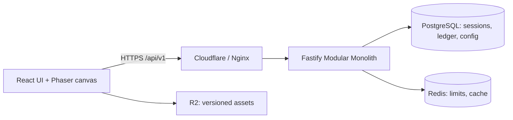

# Fishing World Online — Bản bàn giao đầu tiên

07/11/2026 · Discovery v0.1 · Một developer chính20 giờ/tuần, theo xác nhận của chủ dự án. Các lựa chọn dưới đây là đề xuất để triển khai theo task nhỏ. Chưa có ứng dụng chạy, người chơi thử, doanh thu hoặc hạ tầng được provision.

## 1. Executive Summary

Xây web game câu cá2D với một vòng chơi đủ sâu trước khi mở rộng thế giới: phản ứng khi phao chìm, giữ/nhả để cân bằng lực kéo và độ căng, nhận cá/XP/Gold do server xác nhận, sưu tập và nâng cấp. Đề xuất side-view, một Hồ Sen,10 loài cá Việt Nam, phiên ngắn5–10 phút; React lo giao diện, Phaser 3 lo cảnh/input/animation.

MVP có đăng ký/đăng nhập, profile, inventory/equipment, shop Gold, nhiệm vụ ngày, bộ sưu tập, leaderboard bất đồng bộ và admin. Không thanh toán thật ở MVP. Định hướng hybrid doanh thu giữ ở roadmap sau review pháp lý và retention. Modular Monolith giúp transaction cá/ví/XP nhất quán với chi phí vận hành ban đầu thấp.

Với20 giờ/tuần: backlog ước lượng506–771 giờ, cộng dự phòng thành 633–1.041 giờ, khoảng 32–53 tuần làm việc; lịch base46 tuần. Chưa tính thời gian thụ lý pháp lý hay feature identity chưa xác định. Một prototype nội bộ có thể nghiệm thu trước, không chờ toàn MVP mới quan sát người chơi nội bộ.

## 2. Product Vision

**Một góc hồ Việt Nam trong trình duyệt: chơi vài phút, học một kỹ năng, mỗi ngày thêm một kỷ lục.** Sản phẩm dành cho casual mobile, người thích câu thật và người thích sưu tập. Lý do quay lại là mục tiêu gần như một nhiệm vụ/đổi cần, cùng mục tiêu dài như album10 loài và cá nặng hơn.

| Giá trị          | Biểu hiện cụ thể                                      | Bằng chứng cần thu                                                              |
| ---------------- | ----------------------------------------------------- | ------------------------------------------------------------------------------- |
| Dễ tiếp cận      | Không cài game; một nút hold/release, hướng dẫn3 lượt | Tutorial>70%, first catch trong3 phút sau vào hồ ở playtest                     |
| Có kỹ năng       | Cá vùng vẫy có tín hiệu, nhả đúng lúc tránh đứt       | Người chơi hiểu vì sao thắng/thua; không chỉ spam request                       |
| Có tiến trình    | XP,3 tier cần, mồi khác nhau, album và record         | Thời gian mua cần đầu, D1/D7, tỷ lệ hoàn thành album                            |
| Gần gũi Việt Nam | Hồ Sen, cá rô/chép/lóc, UI tiếng Việt                 | Phỏng vấn và cohort phản hồi, không tự coi bản địa hóa là lợi thế đã chứng minh |

Mục tiêu thử nghiệm: activation>50%, D1 khoảng 25–30%, D7 khoảng 10–15%, crash-free>99%. Mọi số là giả thuyết. Định nghĩa mẫu số/ngày/cohort trong [PRD](PRD.md).

## 3. Competitor Analysis

Đã đọc website chính thức ngày 07/11/2026; chưa có playtest đối thủ hoặc số doanh thu độc lập. “Thành công” không được suy ra thành lợi nhuận.

| Đối thủ / nguồn                                                              | Điều quan sát                                                        | Bài học / hướng khác biệt                                               |
| ---------------------------------------------------------------------------- | -------------------------------------------------------------------- | ----------------------------------------------------------------------- |
| [Fishing Planet](https://fishingplanet.com/)                                 | Mô phỏng first-person 3D, multiplayer, vật lý, free-to-play/DLC      | Học cảm giác cá có sức nặng; MVP không cạnh tranh độ chân thực          |
| [Fishing Clash — Ten Square Games](https://tensquaregames.com/our-games/)    | Fishing simulator 3D, nhiều cá/hồ, portfolio free-to-play            | Nội dung hình ảnh quan trọng; bắt đầu một hồ rõ loop thay vì nhiều cảnh |
| [Let's Fish](https://lets-fish.com/)                                         | Browser, collection, mở hồ theo cấp, ranking/event/club              | Browser đã có đối thủ; “không cần cài” chưa đủ để khác biệt             |
| [WEBFISHING — bản JAM của tác giả](https://lamedeveloper.itch.io/webfishing) | Không khí thân thiện, câu cá/cosmetic; tác giả nói bản Steam làm lại | Học cảm giác thư giãn; không suy tính năng/giá Steam từ JAM             |

Khác biệt đề xuất: một tay trên mobile, loài/hồ Việt, phiên ngắn, kỹ năng kéo/nhả dễ đọc, không bán sức mạnh bằng tiền thật. Cần phỏng vấn12–15 người và playtest10 người để phản biện định vị. Nguồn, giới hạn và kế hoạch nghiên cứu tiếp trong [COMPETITORS](COMPETITORS.md).

## 4. Gameplay Concept

| Góc nhìn  | Effort/asset                                    | Mobile/trải nghiệm                           | Quyết định                        |
| --------- | ----------------------------------------------- | -------------------------------------------- | --------------------------------- |
| Top-down  | Vừa; map và nhiều hướng nhân vật                | Tốt cho khám phá, cần thêm điều khiển        | Để cân nhắc khi có nhu cầu đi lại |
| Side-view | Thấp nhất; một nền nhiều lớp và bộ động tác câu | Phao/cần/dây rõ, vùng chạm rộng, dễ portrait | Đề xuất MVP                       |
| Isometric | Cao; phối cảnh/sorting/asset                    | Đẹp, vật nhỏ khó chạm và nhiều QA            | Chưa phù hợp Lean                 |

Loop: sảnh → Hồ Sen → chọn trang bị/mồi → cast → chờ3–8s → hook → hold/release theo tension → catch/escape → server commit → collection/Gold/XP → mua mồi/nâng cần → câu tiếp.

Đủ state: IDLE → CASTING → WAITING → BITE → HOOKING → FIGHTING → REELING → CAUGHT hoặc ESCAPED → FINISHED. Hook window theo loài1,4–2,4s, tutorial dễ hơn; fight input 4Hz, simulation server 50ms có cap. Không thưởng theo số lần bấm.

10 loài: chép, trắm, rô phi, lóc, trê, tra, mè, rô, tai tượng, diêu hồng. Rarity baseline 55/25/13/5/2 là tỷ trọng thử nghiệm trước modifiers. Spawn phụ thuộc hồ/mồi/trang bị/cấp/giờ và config version; server dùng RNG, không trả trước fish/weight/reward. Bảng số liệu/animation/sound/transition chi tiết tại [GDD](GAME_DESIGN.md).

## 5. MVP Scope

| Phải có trước beta        | Phạm vi tối thiểu                                                                               |
| ------------------------- | ----------------------------------------------------------------------------------------------- |
| Account/profile           | Register/login/logout/refresh/reset/session management; preset avatar, XP/level/Gold/stats      |
| Game                      | Một hồ,10 loài, loop10 state, hiệu ứng/animation/âm cơ bản, responsive                          |
| Equipment/economy         | Cần gỗ/tre/composite, dây/lưỡi starter, giun/ngô/cám, nâng cần có cap; inventory và shop Gold   |
| Tiến trình                | Collection/count/max weight/hồ,3daily,3 achievement danh hiệu, leaderboard chỉ đọc              |
| Quản trị                  | RBAC4role, CRUD data/giá/mồi/mission, preview/publish config, user support/audit/analytics      |
| Chất lượng                | Logging/redaction, anti-cheat/transaction/replay tests, backup/restore, CI/staging và mobile QA |
| Điều kiện beta ngoài nhóm | Phân loại/thủ tục/tài khoản/age/guardian/time/privacy được rà soát và triển khai phù hợp        |

Chưa có chat/guild/trading/marketplace, nhiều hồ, event engine, multiplayer phức tạp, payment/premium/adsSDK hay AI NPC. Betting/cash-out/đổi Gold ra tiền không nằm roadmap. Sitemap đủ 15 nhóm màn trong [UI_UX](UI_UX.md), có design tokens và loading/empty/error/populated cho cả nested flows.

## 6. Feature Prioritization

| Thứ tự | Nhóm                                       | Tại sao trước/sau                                        |
| ------ | ------------------------------------------ | -------------------------------------------------------- |
| P0.1   | Foundation/auth/content                    | Có môi trường tái lập và người chơi hợp lệ               |
| P0.2   | Ledger/inventory + server fishing          | Chứng minh integrity trước hình ảnh cuối                 |
| P0.3   | Phaser prototype + tích hợp                | Kiểm chứng cảm giác chơi sớm bằng shapes                 |
| P1.1   | Art/audio + profile/collection/shop/daily  | Hoàn thành giá trị tiến trình và nội dung MVP            |
| P1.2   | Admin/analytics/QA/staging/legal readiness | Vận hành/cân bằng/đo dữ liệu an toàn trước beta          |
| P2     | Nội dung/social/doanh thu                  | Chỉ bắt đầu sau bằng chứng nhu cầu, retention và pháp lý |

P1 vẫn bắt buộc MVP theo master prompt. [BACKLOG](BACKLOG.md) có 21 task, dependency, effort và acceptance; task đầu F01 chỉ workspace/tooling, không viết toàn bộ game. [AGENT_WORKFLOW](AGENT_WORKFLOW.md) phân vai/input/output/ownership và nghiệm thu.

## 7. Technical Architecture

Giữ stack: React/TypeScript/Vite/Phaser 3/Zustand/TanStack Query/CSS Modules/pnpm; Fastify/Node/TS/Zod/Prisma; PostgreSQL/Redis; Docker/Actions/Cloudflare/VPS/R2.

React không chạy từng frame; Phaser chỉ render/input/nội suy. Zustand giữ UI preferences, Query giữ cache API, không là nguồn ví. Một API chia module theo nghiệp vụ; admin dùng cùng domain service với RBAC/audit. REST đủ cho phiên riêng, Socket.IO để sau khi số đo/feature yêu cầu.

Ưu: một deployment, ít chi phí, transaction phần thưởng đơn giản. Nhược: cần giữ boundaries, DB là bottleneck/điểm lỗi khi chưa HA; scale cần benchmark. 100 CCU benchmark đầu không phải cam kết một VPS chịu mọi tải. Cấu hình/giá theo CCU và phân biệt registered users tại [DEPLOYMENT](DEPLOYMENT.md).

## 8. Database Overview

Nhóm dữ liệu: users/profiles/sessions; fish/locations/weights/equipment/bait; inventory/loadout/collection; fishing sessions/actions/catches; wallet/ledger/orders; mission/achievement; admin/audit/config; idempotency/analytics/grants. UUID PK, FK, UTC, unique/index, soft delete phù hợp.

- Gold BigInt, serialize decimal string; gram integer; XP threshold `100×(L−1)^2`.
- Catch+ledger+XP+collection+mission+analytics business event trong một transaction; unique session catch và source reward chống nhận 2 lần.
- SQL migration cần partial unique active session và config active; CHECK không âm, trigger/quyền append-only ledger/audit.
- Mission snapshots giữ target/reward/ngày; rescue5 giun có grant unique mỗi người/ngày, không tạo Gold.
- Schema Prisma ở `docs/design/schema.prisma` là thiết kế, đã validate trực tiếp bằng CLI 7.10.1. Chưa có migration/seed/DB đang chạy; tasks F02/G02 phải chứng minh transaction trên PostgreSQL thật.

[DATABASE](DATABASE.md) có ERD/index/backup; [API](API.md) có `/api/v1`, request/response/auth/error/authorization và kế hoạch generate OpenAPI khi implement.

## 9. Monetization Strategy

MVP doanh thu giao dịch thật bằng 0. Tương lai thử cosmetic, membership tiện ích/cosmetic, rewarded ads tự nguyện có cap, affiliate nội dung, sponsorship có hợp đồng; từng mô hình phải qua legal review, không mua sức mạnh/xác suất/cash-out.

| Kịch bản giả định sau phê duyệt                | Conservative |        Base |   Optimistic |
| ---------------------------------------------- | -----------: | ----------: | -----------: |
| MAU / pay conversion                           |    1.000 /1% |   5.000 /2% |   15.000 /3% |
| Gross ARPPU/tháng                              |      80.000đ |    100.000đ |     120.000đ |
| Net revenue/tháng*                             |  0,688 triệu | 8,842 triệu | 48,404 triệu |
| Cash surplus trước dev/marketing/thuế thu nhập | −1,612 triệu | 3,342 triệu | 31,904 triệu |

`*` Sau giả định hoàn tiền/VAT/phí/ads realization; không là thuế suất hoặc báo giá đã xác minh. Nếu tính25 triệu công developer và 3 triệu marketing/tháng, base cash break-even đầy đủ khoảng 21.794 MAU khi unit contribution giữ nguyên. Mô hình này để kiểm tra độ nhạy, không cam kết doanh thu. Công thức ARPU/ARPPU/conversion/churn/LTV/CAC/break-even trong [MONETIZATION](MONETIZATION.md).

Marketing30ngày bắt đầu khi beta hợp lệ:5 triệu trần gồm 1,2 triệu nội dung,1,3 triệu creator,0,6 triệu cộng đồng,0,4 triệu công cụ,0,3 triệu referral QA,0,7 triệu paid có gate và 0,5 triệu dự phòng. Không bắt buộc tiêu hết hoặc hứa đủ 1.000 người; dừng tăng paid khi retention chưa đạt. [MARKETING](MARKETING.md) có lịch và nội dung/trailer storyboard; chưa sản xuất video hay đăng bài.

## 10. Roadmap

| Mốc base              | Tuần làm việc | Kết quả                                                                     |
| --------------------- | ------------- | --------------------------------------------------------------------------- |
| Discovery/Foundation  | 1–8           | Quyết định, workspace/auth/DB/CI                                            |
| Backend Core          | 9–15          | Transaction/equipment/shop/fishing server                                   |
| Game Core/Integration | 16–27         | Prototype → assets → loop và tiến trình đầy đủ                              |
| Admin/QA/staging      | 28–36         | Config/analytics, security/load/mobile/restore                              |
| Closed Beta           | 37–42         | Hai cohort đủ D7, sửa onboarding/balance; gate pháp lý trước mời ngoài nhóm |
| Public readiness      | 43–46         | Nghiệm thu, hồ sơ phù hợp, monitoring/support/manual release                |

Dải32–53 tuần ở20 giờ/tuần; phụ thuộc pháp lý/asset có thể làm lịch dài hơn. Làm task nhỏ, update estimate sau prototype. [ROADMAP](ROADMAP.md), [BACKLOG](BACKLOG.md), [TEST_PLAN](TEST_PLAN.md).

## 11. Risks & Legal Considerations

Rủi ro lớn: loop thiếu hấp dẫn, scope vượt thời gian, latency mobile làm miss hook, nhân Gold qua replay/race, cấu hình admin sai, mobile FPS thấp, VPS đơn điểm, license asset và mô hình doanh thu không bù công phát triển. Mỗi rủi ro có trigger/owner/cách giảm tại [RISK_REGISTER](RISK_REGISTER.md); threat matrix và checklist tại [SECURITY](SECURITY.md).

Nguồn Chính phủ đã đọc cho biết NĐ 147/2024 có hiệu lực25/12/2024; bài nêu hạn chế virtual items/currency/trading, thông tin tên/ngày sinh/số điện thoại, guardian dưới16, lưu thông tin. Nguồn Chính phủ khác nêu Luật Bảo vệ dữ liệu cá nhân2025 có hiệu lực01/01/2026. Không chỉ dựa quy định2024 khi dự kiến ra mắt2026+.

**Chưa kết luận G1/G2/G3/G4.** Cần đối chiếu tương tác server-authoritative, leaderboard và mọi social feature với toàn văn hiện hành. Chưa hoàn tất kiểm tra văn bản sửa đổi/thủ tục/chủ thể phát hành; [LEGAL](LEGAL.md) ghi nguồn chính thức, ngày, những gì đã đọc và phần chưa xác minh. Miễn phí/closed beta không tự miễn nghĩa vụ. Email/password chỉ là bản nội bộ tới khi đáp ứng tài khoản/tuổi/guardian/time/privacy phù hợp.

## 12. Những quyết định cần chủ dự án xác nhận

| Quyết định                | Đề xuất                                                               | Trạng thái                             |
| ------------------------- | --------------------------------------------------------------------- | -------------------------------------- |
| Năng lực phát triển       | Một developer20 giờ/tuần                                              | Đã xác nhận trong hội thoại            |
| Góc nhìn và phạm vi       | Side-view, Hồ Sen,10 loài, Gold-only, chưa payment/chat               | Đề xuất mặc định cho lần review đầu    |
| Phong cách asset          | Minh họa2D cách điệu, asset có license; shapes trong prototype        | Chưa chốt art direction/ngân sách      |
| Quy mô đầu                | Load target 100 CCU, beta tuyển nhóm nhỏ trước                        | Chưa đo, không SLA                     |
| Chủ thể/ngân sách pháp lý | Chọn đơn vị phát hành và tư vấn trước beta ngoài nhóm                 | Chưa có thông tin                      |
| Ngân sách vận hành        | MVP giả định0,72–2,65 triệu/tháng, chưa tính phát triển/asset/pháp lý | Chưa duyệt ngân sách, chưa mua dịch vụ |

Không cần hỏi lại stack, pnpm, thị trường, tiếng Việt hay việc không cash-out. Câu hỏi quyết định tiếp theo nên chỉ chốt gói **side-view + một Hồ Sen + Gold-only** trước F01. Các câu hỏi asset/hosting/pháp nhân hỏi theo thời điểm cần, từng câu một. Không tạo source toàn game trong bản bàn giao đầu tiên.
