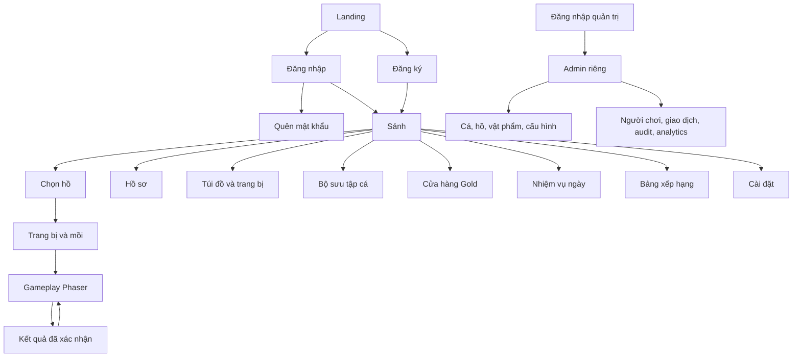

# UI/UX — Sitemap, user flow và design system

## Cập nhật runtime — 07/11/2026: mồi, cấp và avatar

- Nút mồi tại hồ có chỉ dẫn bấm đổi và mũi tên; selector giải thích các loại mồi thu hút loài cá khác nhau, không hứa bảo đảm bắt được cá. Đang câu không đổi snapshot mồi.
- Thả câu khi hết mồi mở modal cảnh báo/mua tại đúng hồ. Chọn mồi/gói, thấy tổng Gold, lỗi field/thiếu Gold, loading/empty/error và retry; mua xong chọn mồi mới nhưng chỉ thả khi người chơi bấm lại. Giá/phí vào hồ không đổi và không phát sinh lượt/phí từ việc xem/mua.
- Header luôn hiện cấp/XP còn thiếu, cả trên mobile. Sảnh và hồ sơ có thanh XP từ server; sảnh mobile dùng thẻ tiến độ gọn trước hồ. CTA Đổi ảnh đại diện dẫn tới lựa chọn bốn biểu tượng và xác nhận OTP; avatar đã lưu đồng bộ trên các khu vực tài khoản/bảng xếp hạng.

Ngày: 07/11/2026. Đây là tài liệu thiết kế, chưa có màn hình hoặc component được triển khai. Repo ban đầu trống, không có shared exports hoặc nearby screen để tái sử dụng; khi bắt đầu UI phải tạo nền dùng chung trong `packages/ui`, sau đó tái sử dụng cho mọi screen/state và kiểm tra exports trước khi thêm component. Tham chiếu workflow: `/Users/hanguyen/.codex/skills/reuse-app-components/SKILL.md`. Không áp dụng tên component/theme Flutter Smartos vào React.

## 1. Sitemap

Game và admin là hai ứng dụng/bundle riêng, dùng chung primitive phù hợp. Không đưa sidebar/bảng thống kê kiểu admin vào sảnh game. Truy cập admin được kiểm tra role tại API; ẩn route không phải authorization.

## 2. Luồng chính

### Người mới → cá đầu tiên

Landing có CTA “Tạo tài khoản chơi thử” → form email, tên hiển thị, mật khẩu và liên kết chính sách → sảnh giải thích ngắn starter items → Hồ Sen miễn phí → loadout đã trang bị starter, cho xem tác dụng mồi → tutorial ba bước ngay trong scene → thả/giật/kéo–nhả → kết quả do server xác nhận → bộ sưu tập có loài đầu → CTA “Câu tiếp” hoặc “Về sảnh”. Chưa hứa “chơi ngay không tài khoản” khi backend chưa có guest flow.

Không bắt đọc toàn bộ hướng dẫn trước cast. Tutorial vẫn cho xem lại. Nếu đăng ký thất bại, giữ các dữ liệu an toàn và lỗi gắn đúng field, không xóa form hoặc làm lộ email có tồn tại qua quên mật khẩu.

### Người quay lại → mục tiêu ngày

Đăng nhập → sảnh hiển thị nhiệm vụ gần hoàn thành và tiến trình XP → vào hồ gần nhất → catch → claim daily một lần → shop mua mồi/đổi cần bằng Gold → equip → tiếp tục. Mua hàng hiển thị giá, số dư sau mua và quantity trước xác nhận; không mặc định mua nhiều hoặc thêm currency cao cấp.

### Mất kết nối / refresh

Hiển thị banner có trạng thái và retry; khóa thao tác mutation khi chưa xác định kết quả. Khi tải lại, truy vấn phiên đang hoạt động hoặc kết quả cuối rồi đồng bộ inventory/wallet/collection. Không tự trừ/hoàn mồi hoặc cộng Gold trong React. Back button trong fight hỏi xác nhận rời phiên vì có thể mất mồi; không dùng hộp xác nhận ở mọi nút bình thường.

## 3. Bố cục theo thiết bị

### Túi đồ có hai tab — 07/11/2026

Giỏ cá tại hồ dùng Modal `size="wide"`, tối đa 900px và chừa lề màn hình; các dialog xác nhận vẫn dùng kích thước mặc định. Lưới giỏ tự giảm số cột theo chiều rộng khả dụng. Các thẻ cùng hàng đồng bộ vị trí khung ảnh, độ hiếm, tên, trọng lượng và hàng đổi Gold; tên dài được xuống dòng, nhãn độ hiếm và nút Đổi cá giữ một dòng. Ảnh thật giữ toàn bộ tỷ lệ qua FishArt.

`/play/inventory` mặc định mở **Trang bị**; tab **Giỏ cá của bạn** chỉ hiển thị giỏ cá và luồng đổi Gold. Bộ lọc cần/dây/lưỡi/mồi cùng lối tắt tủ đồ nằm trong tab Trang bị, không đẩy giỏ xuống dưới danh sách vật phẩm. Tab dùng shared `Tabs`, nhãn Việt–Anh và trạng thái chọn có tên truy cập riêng.

Nút **Mở giỏ cá** ở kết quả câu hoàn tất lượt đã kết thúc rồi mở giỏ bằng shared `Modal` ngay tại hồ; header hồ cũng có icon giỏ cá khi không có lượt đang câu. Xem/đổi cá không tạo session mới hoặc thu phí; đóng giỏ để câu tiếp, giữ hồ, mồi và thiết lập ném. URL `?location=<id>` giữ đúng hồ thực tế, kể cả khi resume lượt rồi đóng kết quả. Lỗi complete giữ kết quả để thử lại. Escape trong xác nhận đổi chỉ đóng xác nhận; Escape tiếp theo mới đóng giỏ. Hồ có phí hiển thị phí của lượt thả câu mới; backend vẫn thu phí khi tạo session, không đổi thành phí theo thời gian ở hồ.

Giỏ vẫn truy cập được từ `/play/inventory?tab=catches`. URL giữ tab khi tải lại và khi dùng Back/Forward; đổi tab giữ các query parameter khác và bộ lọc trang bị trong lần xem. `/play/equipment` vẫn dành riêng cho trang bị. Mỗi tab giữ loading/empty/error/retry và dialog hiện có; chỉ mount giỏ khi chọn tab đó.

### Màn câu gọn và phản hồi thư giãn — 07/11/2026

Cảnh 3D là vùng chính trên desktop và mobile. Cụm điều khiển dưới cảnh chỉ có trạng thái ngắn, nút thả/giật/giữ–nhả và thanh công cụ. Không hiện thanh 0% khi chưa đấu cá. Khi đấu, hai chỉ số căng dây/tiến độ nằm trong HUD nhỏ trên cảnh; độ bền dây, tải cần, sức cá, khoảng cách và thời tiết đầy đủ mở bằng nút Thông số. Hướng/lực/tầng nước và drag/hướng cần đóng mặc định, mở bằng nút Chỉnh. Mồi/trang bị mở trong Modal dùng chung, không cần sidebar thường trực; cộng đồng chỉ tải khi mở.

Âm thanh mặc định bật nhưng chỉ bắt đầu sau thao tác thật ở màn câu. Nhạc ngũ cung nhẹ, tiếng gió/nước, nước bắn, cá đớp và máy câu dùng cùng AudioContext; tắt loa hoặc ẩn tab sẽ suspend, rời màn sẽ đóng context. Rung là tùy chọn riêng, không phụ thuộc loa: nhịp nhẹ khi cá chạm mồi, nhịp đôi khi đớp, nhịp theo sức căng lúc kéo và tín hiệu kết quả. Chỉ chạy khi tab hiển thị trên trình duyệt/thiết bị có Vibration API; giảm chuyển động loại bỏ rung lắc thị giác và animation nhấp nháy. Snapshot server điều khiển chuyển động nhân vật, độ cong cần, phao nghiêng/chìm và độ chùng dây.

Nghiệm thu: 320/390/1440px không tràn ngang; đóng/mở các bảng và Modal trả focus; giữ/nhả bằng pointer/Space và blur/cancel; loading, hết mồi, lỗi/reconnect; loa bật/tắt, dừng âm khi rời màn, rung hoạt động độc lập với loa. Rung vật lý và cảm giác âm thanh cần playtest trên iOS/Android thực, không suy ra từ Chromium headless.

| Khu vực                | Desktop/tablet rộng                                           | Mobile portrait                                                                                      |
| ---------------------- | ------------------------------------------------------------- | ---------------------------------------------------------------------------------------------------- |
| Sảnh                   | Minh họa hồ làm trung tâm, thẻ nhiệm vụ/túi đồ quanh cảnh     | Cảnh hồ phía trên, CTA Chơi rõ, các mục ít cột                                                       |
| Gameplay               | Cảnh khoảng 16:9, HUD gọn trên/dưới; bên phải chỉ khi đủ rộng | Cảnh co theo khung, nút chính dưới; không ép xoay ngang; thanh lực và căng đọc được                  |
| Túi đồ/shop/collection | Grid và panel chi tiết hoặc dialog                            | Grid 2 cột khi đủ, chi tiết bottom sheet/fullscreen; CTA không che nội dung                          |
| Form                   | Card có chiều rộng giới hạn, label luôn nhìn thấy             | Full-width trong padding token; bàn phím không che lỗi/submit                                        |
| Admin                  | Table với tìm kiếm/lọc, pagination và panel chi tiết          | Hỗ trợ tối thiểu xem/khẩn cấp; bảng scroll có label, không ưu tiên vận hành phức tạp trên điện thoại |

Mục tiêu kiểm tra 360×640, 390×844, 768×1024 và 1440×900. Vùng chạm ít nhất 44×44 CSS px, ưu tiên 48px cho nút gameplay. Text không bị mất khi tăng 200%; các nhãn dài wrap hoặc có tên truy cập đầy đủ. Không khóa browser zoom. Bottom action dùng một shared container tính safe-area và padding, tránh lồng nhiều lớp inset.

## 4. Design tokens đề xuất

### Chuyển động UI đang triển khai

- Shared styles định nghĩa `--motion-fast` (160ms), `--motion-normal` (240ms), `--motion-enter` (380ms) và easing giảm tốc; nút, toggle, điều hướng, trạng thái, toast và mở modal dùng chuyển động ngắn. Đổi route game dùng fade, không chạy lại khi dữ liệu phiên câu cập nhật.
- “Cách chơi” và “Hành trình” cuộn mượt tới section, chuyển focus cho bàn phím và hỗ trợ URL có hash. Liên kết vẫn hiện trên mobile; section hiện nhẹ khi đi vào viewport bằng IntersectionObserver, có fallback nội dung hiện sẵn.
- “Giảm chuyển động” áp dụng cho DOM qua `data-reduced-motion`, đồng thời giữ tùy chọn của cảnh 3D hiện có. `prefers-reduced-motion` của hệ điều hành luôn được tôn trọng; tắt delay/lặp và cuộn mượt, giữ nội dung đọc được. Không thêm chuyển động lặp trang trí hoặc trì hoãn thao tác gameplay.
- Nghiệm thu: kiểm liên kết bằng chuột/bàn phím, hash trực tiếp, lịch sử Back, toggle Settings, layout Việt–Anh 320/1440px và regression focus/modal/menu. Hiệu năng FPS và cảm giác trên thiết bị thật cần playtest riêng.

Màu được định nghĩa tại theme layer bằng CSS variables semantic; feature không hardcode palette. Giá trị sau là thiết kế ban đầu, phải đo contrast trước nghiệm thu.

| Token                    | Giá trị đề xuất                               | Vai trò                                             |
| ------------------------ | --------------------------------------------- | --------------------------------------------------- |
| `color.bg.page`          | `#F4F8F2`                                     | Nền ngoài cảnh                                      |
| `color.bg.surface`       | `#FFFFFF`                                     | Form, card, modal                                   |
| `color.bg.water`         | `#D8EEF2`                                     | HUD/nền nước nhẹ; không dùng làm text               |
| `color.text.heading`     | `#173B34`                                     | Tiêu đề                                             |
| `color.text.primary`     | `#213C36`                                     | Nội dung                                            |
| `color.text.secondary`   | `#52665F`                                     | Metadata                                            |
| `color.action.primary`   | `#166B56`                                     | Nút chính                                           |
| `color.action.onPrimary` | `#FFFFFF`                                     | Nhãn nút chính                                      |
| `color.status.success`   | `#1A6B42`                                     | Thành công                                          |
| `color.status.warning`   | `#805300`                                     | Cảnh báo/độ căng                                    |
| `color.status.danger`    | `#B42332`                                     | Lỗi/đứt dây                                         |
| `color.border.default`   | `#C8D5CB`                                     | Ranh giới field/card; input cần contrast phù hợp    |
| `color.focus.ring`       | `#245FCA`                                     | Focus keyboard                                      |
| `color.rarity.*`         | Common/Uncommon/Rare/Epic/Legendary qua theme | Luôn đi kèm nhãn, không dùng màu làm nghĩa duy nhất |

- Typography: font hệ thống hỗ trợ tiếng Việt đầy đủ; body 16px/1.5, metadata 14px/1.4, heading 20/24/32px theo cấp. Không đưa font tải lớn vào critical path khi chưa cần.
- Spacing: 4, 8, 12, 16, 24, 32, 48px; padding page mobile 16px, desktop 24–32px. Feature dùng token, không tự thêm số lẻ.
- Radius: input/button 10px, card 16px, modal 20px, pill 999px. Shadow: `surface` nhẹ, `overlay` rõ; tránh dùng shadow thay contrast bắt buộc.
- Motion: phản hồi 120–180ms, chuyển panel 180–240ms; honor `prefers-reduced-motion`. Gameplay có animation riêng nhưng không phụ thuộc motion để báo state.

## 5. Các component dùng chung cần xây trước

| Component/nhóm                                   | Contract và phạm vi tái sử dụng                                                                                |
| ------------------------------------------------ | -------------------------------------------------------------------------------------------------------------- |
| `Button`, `IconButton`, `BottomActions`          | variant, size, loading, disabled, focus, safe-area; không nhân đôi implementation theo màn                     |
| `FormField`, `TextInput`, `PasswordInput`        | Label/help/error/required/aria, toggle password; register/login/admin dùng cùng field interaction              |
| `Card`, `Dialog`, `Sheet`, `Tabs`                | Focus trap/restore, Escape, scroll và close semantics; responsive bằng option tương thích                      |
| `EmptyState`, `LoadingState`, `ErrorState`       | Icon/heading/message/CTA, kích thước compact/full; retry và nội dung theo feature                              |
| `Toast`, `InlineNotice`, `Tooltip`               | Toast không làm mất lỗi quan trọng; tooltip có focus/touch, không chứa hành động bắt buộc                      |
| `ItemCard`, `ItemDetail`, `QuantitySelector`     | Tên, rarity label, số lượng, owned/equipped, giá, actions; shop/inventory dùng chung presentation              |
| `CurrencyAmount`, `LevelProgress`, `RarityBadge` | Format theo locale đã chọn (vi-VN/en-GB), giá trị không đến từ scene dự đoán; nhãn đọc được bằng screen reader |
| `FishCard`, `FishDetail`                         | Seen/unseen/caught, count, best weight, habitat; ảnh có alt phù hợp                                            |
| `GameStatus`, `ActionControl`, `TensionMeter`    | UI bridge tới Phaser/server, trạng thái input và retry; không tự quyết định catch/reward                       |

Feature-specific API/permission logic nằm trong feature; `packages/ui` không import ngược feature. Không tạo component cho từng div; chỉ tách interaction trọn vẹn có khả năng tái sử dụng. Shared exports là điểm kiểm tra bắt buộc trước khi xây screen tiếp theo.

## 6. State matrix cần nghiệm thu

| Màn/flow            | Loading                       | Empty                              | Error                                   | Populated / nested flow                           |
| ------------------- | ----------------------------- | ---------------------------------- | --------------------------------------- | ------------------------------------------------- |
| Sảnh/hồ             | Skeleton nhẹ + trạng thái tải | Chưa có hồ phù hợp, không CTA sai  | Retry/cấu hình bảo trì                  | Một Hồ Sen, hồ khóa ghi điều kiện rõ              |
| Inventory/equipment | Không giả số dư               | Hết mồi → shop hoặc cứu trợ hợp lệ | Equip lỗi giữ item cũ từ server         | Chi tiết, equip/unequip, quantity, mua bù         |
| Collection          | Skeleton card                 | Hướng dẫn bắt cá đầu, CTA vào hồ   | Retry không xóa collection cache hợp lệ | Cá chưa thấy/đã thấy, chi tiết kỷ lục             |
| Shop                | Loading giá authoritative     | Không có item đang bán             | Không đủ Gold, item ngừng bán, giá đổi  | Xác nhận giá/số lượng, receipt, retry idempotent  |
| Missions            | Tải occurrence ngày           | Đã hết nhiệm vụ hôm nay            | Claim retry kết quả cũ                  | Progress, claimable, claimed, hết hạn/grace       |
| Gameplay            | Asset progress thật, timeout  | Chưa chọn hồ/mồi                   | Offline, expiry, invalid equipment      | Đủ 10 state và modal kết quả/thoát                |
| Auth/profile        | Submit loading                | Không áp dụng hoặc hồ sơ mới       | Field/server/rate limit                 | Password reset confirmation không lộ tài khoản    |
| Admin               | Loading/pagination            | Không có dữ liệu phù hợp bộ lọc    | Forbidden và server errors phân biệt    | Edit, preview config, publish, audit confirmation |

## 7. Nội dung và tiêu chí nghiệm thu

- Thẻ nội dung thời trang/thanh toán/admin dùng `Card padded` khi không có layout đệm riêng; chữ, badge và nút không dính viền. Lưới thời trang chọn số cột theo chiều rộng cột editor, nội dung/tên dài xuống dòng và nhóm action không vượt thẻ ở 360px. Thẻ có ảnh/bảng sát mép giữ layout riêng.
- Tab studio nhân vật đọc từ query `tab`, cập nhật URL khi chuyển bằng UI và trở về ngoại hình nếu query không hợp lệ. Kiểm tra cả market có dữ liệu, empty/loading/error, dialog mua/lưu bộ phối và các nhãn Việt–Anh; không suy ra nghiệm thu thiết bị thật từ Chromium viewport emulation.

- UI mặc định tiếng Việt, hỗ trợ chuyển sang tiếng Anh qua catalog có kiểu và selector dùng chung; xem [I18N](I18N.md). Format số/ngày theo locale đã chọn; dữ liệu UTC và múi giờ nghiệp vụ Asia/Ho_Chi_Minh giữ nhãn khi có ý nghĩa. Câu mới dùng tham số trong một key hoàn chỉnh.
- Mỗi action có loading rõ, lỗi có cách xử lý; cảnh báo giá thay đổi trước khi mua. Không hiển thị số người online hoặc số catch toàn cầu giả.
- Keyboard thực hiện được auth, điều hướng, cast, hook, hold/release và đóng result; pointercancel/blur luôn nhả nút. Screen reader nhận lời nhắc state quan trọng qua live region tiết chế, không announce 60 lần/giây.
- WCAG 2.2 AA là mục tiêu cho UI ngoài canvas: contrast text thường ≥4,5:1, text lớn ≥3:1, focus và controls có contrast phù hợp. Canvas có hướng dẫn text và controls DOM; cần kiểm thử người dùng để xác định mức hỗ trợ thực tế của minigame.
- Tải chậm, ảnh lỗi, text dài, zoom, giảm chuyển động, âm bị trình duyệt chặn và safe-area đều có hành vi xác định. Không tuyên bố đạt accessibility trước audit.
